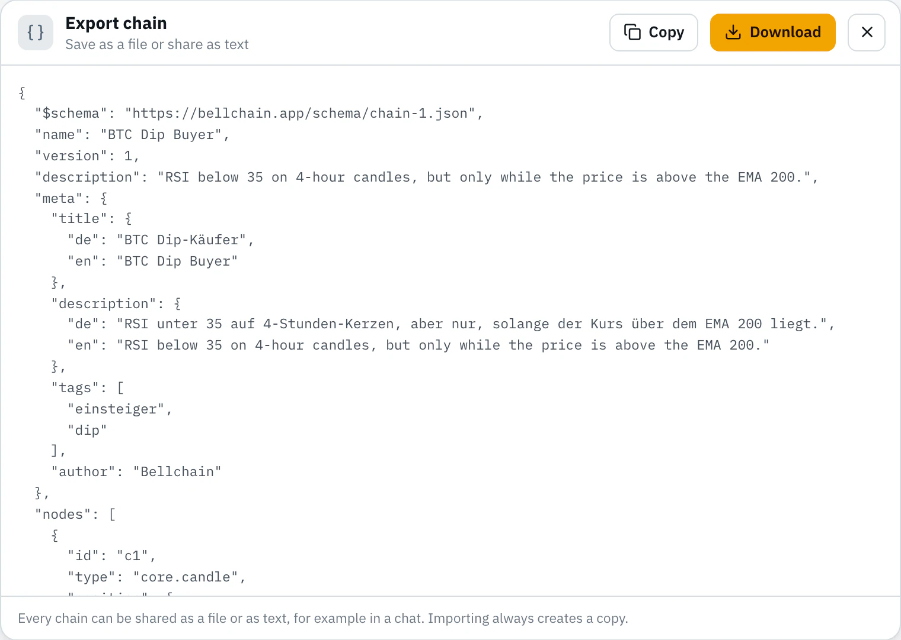

# Contributing a template

Thanks for sharing a chain. This guide goes from the idea to the merged pull request. Auf Deutsch: [CONTRIBUTING.de.md](CONTRIBUTING.de.md)

## What makes a good template

- **One clear idea,** explained in a note on the board: what the chain watches and why.
- **Useful, not noisy:** in a 90-day replay at least one alert and at most about 100.
- **Sample prices:** we test every template on stored prices and show the result as "In test". That works for candles on the candle's default exchange with these markets: BTC/USDT (15m, 1h, 4h, 1d, 1w), ETH/USDT (15m, 1h, 4h, 1d), SOL/USDT (1h, 1d) and XRP, BNB, DOGE, ADA, AVAX, LINK against USDT (1h).
- **No promises:** Bellchain alerts on what you define. It doesn't trade or give advice. Words like "guaranteed", "profit" or "buy signal" don't pass the check.
- **Nothing personal:** URLs of webhooks and Discord, tokens and Telegram chat IDs stay empty. The note says what to enter.

## Step by step

### 1. Build and test in the editor

Open the [editor](https://app.bellchain.app/), no account needed. Build the chain from nodes or start from a template under **Templates**. **Run replay** shows every alert on real prices; without an account the replay covers 15 days, with Pro 90.

### 2. Export

**Export** in the top bar → **Download** saves the chain as a JSON file, for example `eth-rsi-bounce.json`. URLs of webhooks and Discord are left out of the file.



### 3. Fork and add the file

In the browser:

1. Click **Fork** at the top right of this page.
2. In your fork: **Add file** → **Upload files**, drop the file into the folder `templates/` and name it `templates/<name>.json`: lowercase letters, digits and hyphens, 2 to 40 characters.
3. **Commit changes** on a new branch.

With git:

```bash
git clone https://github.com/<your-name>/templates
cd templates
git switch -c eth-rsi-bounce
cp ~/Downloads/eth-rsi-bounce.json templates/
```

### 4. Add the texts

The export contains `name`, `version`, `nodes` and `edges`. Add a `meta` block; this example is from [templates/dip.json](templates/dip.json), shortened:

```json
{
  "$schema": "../schema/chain.schema.json",
  "name": "BTC Dip-Käufer",
  "version": 1,
  "description": "RSI unter 35 auf 4-Stunden-Kerzen, aber nur, solange der Kurs über dem EMA 200 liegt.",
  "meta": {
    "title": { "de": "BTC Dip-Käufer", "en": "BTC Dip Buyer" },
    "description": {
      "de": "RSI unter 35 auf 4-Stunden-Kerzen, aber nur, solange der Kurs über dem EMA 200 liegt.",
      "en": "RSI below 35 on 4-hour candles, but only while the price is above the EMA 200."
    },
    "tags": ["einsteiger", "dip"],
    "author": "your-github-name",
    "notes": {
      "n1": { "de": "Idee: Dips im Aufwärtstrend. …", "en": "Idea: dips in an uptrend. …" }
    },
    "messages": {
      "t1": { "de": "{{kette}}: RSI unter 35 im Aufwärtstrend · {{werte}}", "en": "{{chain}}: RSI below 35 in an uptrend · {{values}}" }
    },
    "tips": [
      { "de": "EMA 100 statt 200 folgt einem kürzeren Trend.", "en": "An EMA 100 instead of 200 follows a shorter trend." },
      { "de": "Ein anderes Paar trägst du in der Kerze ein, etwa ETH/USDT.", "en": "Enter another pair in the candle, such as ETH/USDT." }
    ]
  },
  "nodes": ["…"],
  "edges": ["…"]
}
```

| Field | Rule |
|---|---|
| `meta.title` | Name of the template in `de` and `en`, up to 60 characters. `name` holds the German title. |
| `meta.description` | One sentence for the card in `de` and `en`, up to 140 characters. `description` holds the German text. |
| `meta.tags` | At least one topic: `dip`, `trend`, `momentum`, `volatilitaet`, `volumen`, `ausbruch`, `crash`, `levels`, `smartmoney`, `konfluenz`, `zeit`, `scanner`. Add `einsteiger` if it suits beginners. |
| `meta.author` | Your name or GitHub name. |
| `meta.notes` | For every note on the board (`core.note`) its text in `de` and `en`. The note's `settings.text` holds the German text. |
| `meta.messages` | For every action and message template the message in `de` and `en`. The action's `settings.message` holds the German text. German uses `{{kette}}`, `{{werte}}`, `{{kurs}}`, `{{paar}}`, `{{zeit}}`, English `{{chain}}`, `{{values}}`, `{{price}}`, `{{pair}}`, `{{time}}`; `{{coin}}` works in both. |
| `meta.tips` | At least two tips for adjusting, in `de` and `en`. |
| `meta.test` | Leave it out: we compute it with the sample prices. |

**No German?** Write English in both languages and say so in the pull request; we translate during review. The check only warns then.

### 5. Check locally

You need [Node.js](https://nodejs.org/) 20 or newer, nothing else. In your clone:

```bash
node scripts/check.mjs templates/eth-rsi-bounce.json
```

Without a file name it checks all templates; `--lang de` gives German messages. Each problem shows file, line, place and what to change:

```
templates/eth-rsi-bounce.json:12  error  /meta/description/en
    The description in English is missing

✗ 1 file checked: 1 error, 0 warnings.
```

No Node.js at hand? Skip this step; the pull request runs the same check.

### 6. Open a pull request

In your fork: **Contribute** → **Open pull request**. The form asks what the template does and how often it alerted in the replay. Please change only files in `templates/`.

### 7. The check on GitHub

GitHub Actions runs `node scripts/check.mjs` for every pull request. Problems appear as notes right in your file under **Files changed**. Push fixes to the same branch and the check runs again. For a first contribution, a maintainer may need to start the run.

### 8. Review

We look at idea, texts and alerts, run the replay with the sample prices and fill in "In test". Small fixes we may make ourselves; for bigger ones we'll ask. After the merge, the template appears in the app's gallery with the next release, and your name stays in the file.

## Improve a template

Typos, clearer texts, better thresholds: change the file and open a pull request the same way. If the chain changes, we recompute "In test".

## Ideas and problems

No finished chain yet? Describe your idea as an issue: **Idea for a template**. A template behaves oddly? **Problem with a template**. Questions about your account go to support@bellchain.app.

## How this repository is maintained

This repository is kept in sync with Bellchain's own repository. Templates you contribute are taken over from here; everything else comes from there: the tables in the READMEs, `scripts/check.mjs`, the schema and the license. Pull requests that change those files are closed with a note.

## License

By opening a pull request you agree that your contribution is published under the [MIT License](LICENSE), like everything in this repository.
