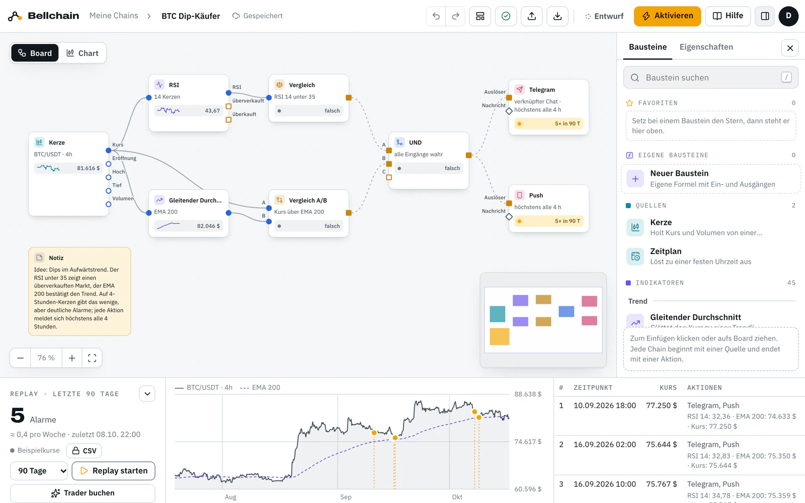
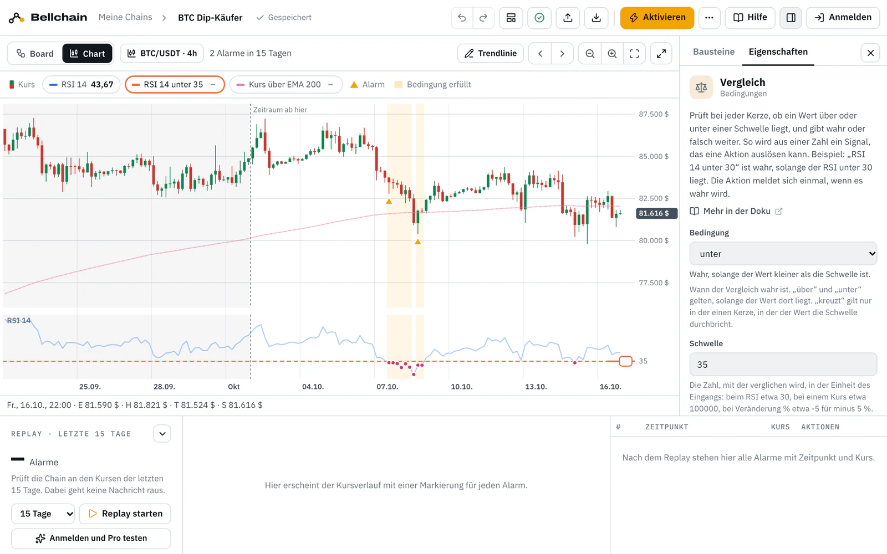
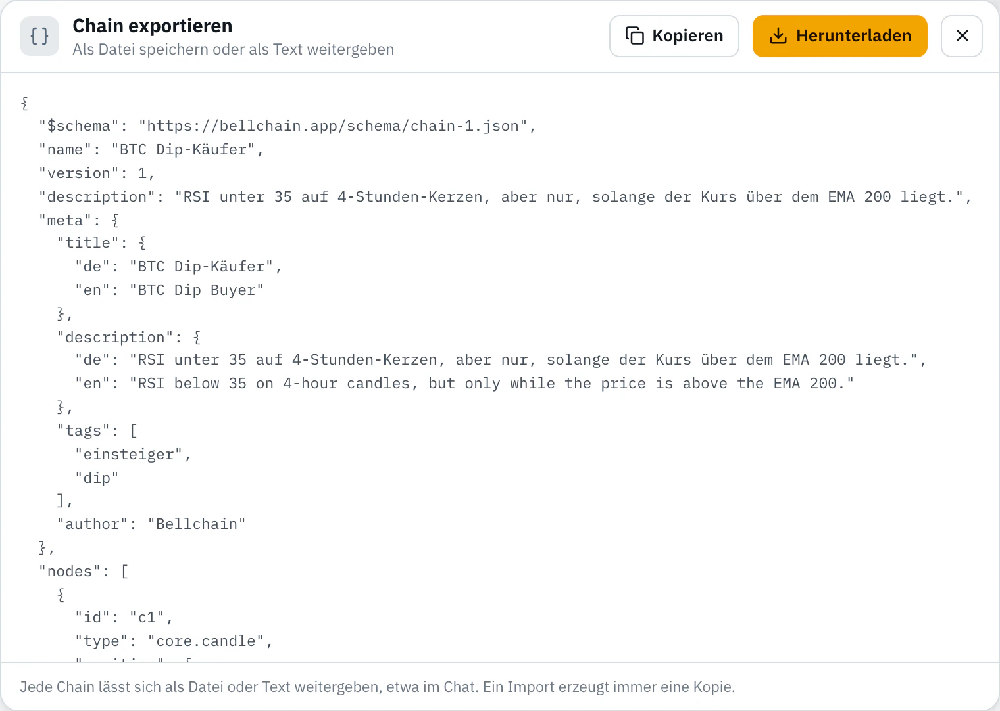

# Vorlagen für Bellchain

Fertige Krypto-Alarme für [Bellchain](https://bellchain.app/de/), den Baukasten für Krypto-Alarme ohne Code. Jede Vorlage ist eine Chain als JSON: eine Kerze, Indikatoren, Bedingungen und Aktionen. Öffne sie im Editor, teste sie im Replay mit echten Kursen, pass sie an und aktiviere sie.

In English: [README.md](README.md)

## Eine Vorlage verwenden

1. Such dir unten in der [Liste](#alle-vorlagen) eine Vorlage aus und klick auf **In Bellchain öffnen**. Sie öffnet sich im Editor, ohne Konto.
2. **Replay starten** zeigt jeden Alarm, den die Chain mit echten Börsenkursen gesendet hätte.
3. Pass Paar, Zeiteinheit oder Schwellen an. Die Notiz auf dem Board erklärt die Idee, die Seite der Vorlage in der Doku hat Tipps.
4. **Aktivieren** schickt echte Alarme per Telegram, Push oder E-Mail. Dafür meldest du dich an; es gibt einen kostenlosen Plan.

Du kannst auch eine Datei aus `templates/` herunterladen und im Editor unter **Importieren** laden.

## Was in diesem Repo liegt

| Pfad | Inhalt |
|---|---|
| `templates/` | Eine Vorlage je Datei, im Chain-Format |
| `schema/chain.schema.json` | Das Chain-Format als JSON-Schema; Editoren wie VS Code prüfen deine Datei damit |
| `scripts/check.mjs` | Die Prüfung, die bei jedem Pull Request läuft; Node.js 20 oder neuer, nichts zu installieren |
| `LICENSE` | MIT |

## Alle Vorlagen

<!-- templates -->
### Free (12)

| Vorlage | Idee | Markt | Im Test¹ | Öffnen |
|---|---|---|---:|---|
| [ADA zurück über dem EMA 200](templates/trend-return.json) | Der Kurs kreuzt den EMA 200 nach oben, und ein RSI über 60 zeigt Schwung dahinter. | ADA/USDT 1h | 10 | [In Bellchain öffnen](https://app.bellchain.app/?template=trend-return) · [Doku](https://docs.bellchain.app/de/templates/trend-return/) |
| [AVAX Tagesverlust per E-Mail](templates/day-drop.json) | Minus 7 % in 24 Stunden: eine E-Mail, höchstens eine pro Tag. | AVAX/USDT 1h | 6 | [In Bellchain öffnen](https://app.bellchain.app/?template=day-drop) · [Doku](https://docs.bellchain.app/de/templates/day-drop/) |
| [BNB weit unter dem Schnitt](templates/ma-gap.json) | Der Kurs liegt 3 % unter dem EMA 50: ein Push, dann 12 Stunden Cooldown. | BNB/USDT 1h | 3 | [In Bellchain öffnen](https://app.bellchain.app/?template=ma-gap) · [Doku](https://docs.bellchain.app/de/templates/ma-gap/) |
| [BTC Dip-Käufer](templates/dip.json) | RSI unter 35 auf 4-Stunden-Kerzen, aber nur, solange der Kurs über dem EMA 200 liegt. | BTC/USDT 4h | 5 | [In Bellchain öffnen](https://app.bellchain.app/?template=dip) · [Doku](https://docs.bellchain.app/de/templates/dip/) |
| [BTC Golden Cross und Death Cross](templates/golden-cross.json) | Der SMA 50 kreuzt den SMA 200 auf 1-Stunden-Kerzen: ▲ Golden Cross, ▼ Death Cross. | BTC/USDT 1h | 12 | [In Bellchain öffnen](https://app.bellchain.app/?template=golden-cross) · [Doku](https://docs.bellchain.app/de/templates/golden-cross/) |
| [DOGE Pump-Melder](templates/pump.json) | Plus 4 % in vier Stunden: Push und Telegram melden den Sprung, danach 12 Stunden Cooldown. | DOGE/USDT 1h | 10 | [In Bellchain öffnen](https://app.bellchain.app/?template=pump) · [Doku](https://docs.bellchain.app/de/templates/pump/) |
| [ETH Crash-Wecker](templates/crash.json) | Minus 3,5 % in vier Stunden. 12 Stunden Cooldown, damit nachts nur ein Alarm kommt. | ETH/USDT 1h | 3 | [In Bellchain öffnen](https://app.bellchain.app/?template=crash) · [Doku](https://docs.bellchain.app/de/templates/crash/) |
| [ETH EMA-Kreuzung 9/21](templates/ema-cross.json) | Der EMA 9 kreuzt den EMA 21 auf 4-Stunden-Kerzen: ▲ nach oben, ▼ nach unten. | ETH/USDT 4h | 38 | [In Bellchain öffnen](https://app.bellchain.app/?template=ema-cross) · [Doku](https://docs.bellchain.app/de/templates/ema-cross/) |
| [ETH Rücksetzer in einer Stunde](templates/quick-drop.json) | Minus 2 % in einer Stunde, gemessen auf 15-Minuten-Kerzen. Ein Push, dann 3 Stunden Cooldown. | ETH/USDT 15m | 12 | [In Bellchain öffnen](https://app.bellchain.app/?template=quick-drop) · [Doku](https://docs.bellchain.app/de/templates/quick-drop/) |
| [LINK RSI-Beobachter](templates/rsi-watch.json) | Schreibt RSI unter 25 und über 75 nur in den Verlauf, ohne Benachrichtigung. | LINK/USDT 1h | 28 | [In Bellchain öffnen](https://app.bellchain.app/?template=rsi-watch) · [Doku](https://docs.bellchain.app/de/templates/rsi-watch/) |
| [SOL Momentum-Schub](templates/momentum.json) | Der RSI steigt über 70, während der Kurs über dem EMA 200 liegt: Der Aufwärtstrend nimmt Fahrt auf. | SOL/USDT 1h | 27 | [In Bellchain öffnen](https://app.bellchain.app/?template=momentum) · [Doku](https://docs.bellchain.app/de/templates/momentum/) |
| [XRP RSI-Wende](templates/rsi-turn.json) | Der RSI verlässt die Extremzonen: ▲ zurück über 25, ▼ zurück unter 75. | XRP/USDT 1h | 26 | [In Bellchain öffnen](https://app.bellchain.app/?template=rsi-turn) · [Doku](https://docs.bellchain.app/de/templates/rsi-turn/) |

### Pro (27)

| Vorlage | Idee | Markt | Im Test¹ | Öffnen |
|---|---|---|---:|---|
| [ADA Trend gewinnt an Kraft](templates/adx.json) | Der ADX steigt über 25: ▲ wenn +DI vorn liegt, ▼ wenn −DI vorn liegt. | ADA/USDT 1h | 29 | [In Bellchain öffnen](https://app.bellchain.app/?template=adx) · [Doku](https://docs.bellchain.app/de/templates/adx/) |
| [Ausbrüche mit Volumen in 9 Coins](templates/breakout-scanner.json) | Einer der 9 Coins knackt sein 50er-Hoch mit mehr als dreifachem Volumen. | 9 Coins · 1h (Scanner) | 71 | [In Bellchain öffnen](https://app.bellchain.app/?template=breakout-scanner) · [Doku](https://docs.bellchain.app/de/templates/breakout-scanner/) |
| [BNB Hammer oder Engulfing](templates/pattern.json) | Ein Hammer oder ein bullisches Engulfing, während der RSI unter 40 liegt. | BNB/USDT 1h | 10 | [In Bellchain öffnen](https://app.bellchain.app/?template=pattern) · [Doku](https://docs.bellchain.app/de/templates/pattern/) |
| [BNB Unruhe-Melder](templates/turbulence.json) | Starke Bewegung oder vierfaches Volumen: ein Push, dann 12 Stunden Cooldown für alle Signale. | BNB/USDT 1h | 21 | [In Bellchain öffnen](https://app.bellchain.app/?template=turbulence) · [Doku](https://docs.bellchain.app/de/templates/turbulence/) |
| [BTC Erst Abverkauf, dann Erholung](templates/sequence.json) | Erst fällt der RSI unter 30, dann kreuzt der Kurs innerhalb von 12 Stunden den EMA 20 nach oben. | BTC/USDT 1h | 11 | [In Bellchain öffnen](https://app.bellchain.app/?template=sequence) · [Doku](https://docs.bellchain.app/de/templates/sequence/) |
| [BTC hohe Schwankung bei fallendem Kurs](templates/hv-falling.json) | Die Historische Volatilität steigt über 40 %, während BTC seit 24 Stunden fällt: Der Markt wird unruhig. | BTC/USDT 1h | 16 | [In Bellchain öffnen](https://app.bellchain.app/?template=hv-falling) · [Doku](https://docs.bellchain.app/de/templates/hv-falling/) |
| [BTC Ichimoku-Wolke](templates/ichimoku.json) | Der Kurs schließt zwei 4-Stunden-Kerzen über der Wolke (▲) oder darunter (▼). | BTC/USDT 4h | 21 | [In Bellchain öffnen](https://app.bellchain.app/?template=ichimoku) · [Doku](https://docs.bellchain.app/de/templates/ichimoku/) |
| [BTC RSI-Divergenz](templates/rsi-divergence.json) | Der Kurs macht ein tieferes Tief, der RSI ein höheres (▲), oder ein höheres Hoch bei tieferem RSI (▼). | BTC/USDT 1h | 25 | [In Bellchain öffnen](https://app.bellchain.app/?template=rsi-divergence) · [Doku](https://docs.bellchain.app/de/templates/rsi-divergence/) |
| [BTC Stopp-Wecker mit ATR-Stopp](templates/stop-alarm.json) | Ein nachgezogener Stopp im Abstand von drei ATR: Der Push kommt, wenn der Kurs ihn reißt. | BTC/USDT 4h | 18 | [In Bellchain öffnen](https://app.bellchain.app/?template=stop-alarm) · [Doku](https://docs.bellchain.app/de/templates/stop-alarm/) |
| [BTC Trendwende mit Supertrend](templates/trend.json) | Meldet, wenn der Supertrend dreht: ▲ nach oben, ▼ nach unten. | BTC/USDT 1h | 59 | [In Bellchain öffnen](https://app.bellchain.app/?template=trend) · [Doku](https://docs.bellchain.app/de/templates/trend/) |
| [BTC über runde Marken](templates/round-numbers.json) | BTC schließt über (▲) oder unter (▼) einer runden Marke im Abstand von 10.000 $. | BTC/USDT 1h | 18 | [In Bellchain öffnen](https://app.bellchain.app/?template=round-numbers) · [Doku](https://docs.bellchain.app/de/templates/round-numbers/) |
| [BTC VWAP-Rückeroberung](templates/vwap.json) | Der Kurs kreuzt den Tages-VWAP mit doppeltem Volumen nach oben, nur zwischen 8 und 22 Uhr. | BTC/USDT 15m | 20 | [In Bellchain öffnen](https://app.bellchain.app/?template=vwap) · [Doku](https://docs.bellchain.app/de/templates/vwap/) |
| [BTC Wochenbericht am Montag](templates/weekly-report.json) | Jeden Montag um 8 Uhr Kurs, Veränderung über sieben Tage und RSI per Telegram und E-Mail. | BTC/USDT 1h | 13 | [In Bellchain öffnen](https://app.bellchain.app/?template=weekly-report) · [Doku](https://docs.bellchain.app/de/templates/weekly-report/) |
| [DOGE Volumen-Explosion](templates/volume-spike.json) | Dreifaches Volumen und mehr als 2 % Bewegung in einer Stunde: ▲ nach oben, ▼ nach unten. | DOGE/USDT 1h | 17 | [In Bellchain öffnen](https://app.bellchain.app/?template=volume-spike) · [Doku](https://docs.bellchain.app/de/templates/volume-spike/) |
| [ETH Heikin Ashi dreht mit dem Trend](templates/heikin-ashi.json) | Heikin Ashi wird grün über dem EMA 50 (▲) oder rot darunter (▼), auf 4-Stunden-Kerzen. | ETH/USDT 4h | 56 | [In Bellchain öffnen](https://app.bellchain.app/?template=heikin-ashi) · [Doku](https://docs.bellchain.app/de/templates/heikin-ashi/) |
| [ETH Konfluenz: 3 von 4](templates/confluence.json) | Mindestens drei von vier Signalen melden „überverkauft“: RSI, Stoch RSI, Bollinger-Band und MFI. | ETH/USDT 1h | 18 | [In Bellchain öffnen](https://app.bellchain.app/?template=confluence) · [Doku](https://docs.bellchain.app/de/templates/confluence/) |
| [ETH MACD-Wende](templates/macd.json) | Der MACD kreuzt seine Signallinie: ▲ unter der Nulllinie nach oben, ▼ über ihr nach unten. | ETH/USDT 4h | 30 | [In Bellchain öffnen](https://app.bellchain.app/?template=macd) · [Doku](https://docs.bellchain.app/de/templates/macd/) |
| [ETH so ruhig wie selten](templates/calm-rank.json) | Die Schwankung von ETH fällt unter den Prozentrang 10: so ruhig wie selten in den letzten 30 Tagen. | ETH/USDT 4h | 6 | [In Bellchain öffnen](https://app.bellchain.app/?template=calm-rank) · [Doku](https://docs.bellchain.app/de/templates/calm-rank/) |
| [ETH Squeeze löst sich](templates/squeeze.json) | Nach einer ruhigen Phase löst sich der Squeeze: ▲ mit Momentum nach oben, ▼ nach unten. | ETH/USDT 4h | 16 | [In Bellchain öffnen](https://app.bellchain.app/?template=squeeze) · [Doku](https://docs.bellchain.app/de/templates/squeeze/) |
| [ETH Wochen-Pivots](templates/pivots.json) | Der Kurs bricht über den Widerstand R1 (▲) oder unter die Unterstützung S1 (▼) der Woche. | ETH/USDT 1h | 14 | [In Bellchain öffnen](https://app.bellchain.app/?template=pivots) · [Doku](https://docs.bellchain.app/de/templates/pivots/) |
| [Große Bewegungen in 9 Coins](templates/moves-scanner.json) | Bewegt sich einer der 9 Coins in einer Stunde um mehr als 4 %, kommt ein Push mit dem Coin. | 9 Coins · 1h (Scanner) | 42 | [In Bellchain öffnen](https://app.bellchain.app/?template=moves-scanner) · [Doku](https://docs.bellchain.app/de/templates/moves-scanner/) |
| [LINK Stochastik dreht unten](templates/stoch.json) | %K kreuzt %D nach oben, während die Stochastik unter 15 liegt. | LINK/USDT 1h | 25 | [In Bellchain öffnen](https://app.bellchain.app/?template=stoch) · [Doku](https://docs.bellchain.app/de/templates/stoch/) |
| [RSI-Scanner über 9 Coins](templates/rsi-scanner.json) | Meldet jeden der 9 Coins, sobald sein RSI unter 25 fällt, höchstens alle 12 Stunden je Coin. | 9 Coins · 1h (Scanner) | 82 | [In Bellchain öffnen](https://app.bellchain.app/?template=rsi-scanner) · [Doku](https://docs.bellchain.app/de/templates/rsi-scanner/) |
| [SOL Ausbruch mit Volumen](templates/brk.json) | Das 20er-Hoch wird geknackt und das Volumen liegt deutlich über dem Schnitt. | SOL/USDT 1h | 35 | [In Bellchain öffnen](https://app.bellchain.app/?template=brk) · [Doku](https://docs.bellchain.app/de/templates/brk/) |
| [SOL Rücklauf zum Ausbruch](templates/breakout-retest.json) | Nach einem Ausbruch über das 20-Kerzen-Hoch kommt SOL innerhalb von 8 Stunden bis auf ±0,5 % an den Ausbruchskurs zurück. | SOL/USDT 1h | 33 | [In Bellchain öffnen](https://app.bellchain.app/?template=breakout-retest) · [Doku](https://docs.bellchain.app/de/templates/breakout-retest/) |
| [SOL Rücksetzer bis 61,8 %](templates/fibonacci.json) | Nach einem Anstieg fällt der Kurs bis zum Fibonacci-Level 61,8 %, dem Goldenen Schnitt. | SOL/USDT 1h | 26 | [In Bellchain öffnen](https://app.bellchain.app/?template=fibonacci) · [Doku](https://docs.bellchain.app/de/templates/fibonacci/) |
| [XRP zurück ins Bollinger-Band](templates/bb-rebound.json) | Der Kurs schließt wieder über dem unteren Bollinger-Band, der RSI liegt noch unter 35. | XRP/USDT 1h | 23 | [In Bellchain öffnen](https://app.bellchain.app/?template=bb-rebound) · [Doku](https://docs.bellchain.app/de/templates/bb-rebound/) |

### Trader (23)

| Vorlage | Idee | Markt | Im Test¹ | Öffnen |
|---|---|---|---:|---|
| [AVAX bricht die Struktur nach unten](templates/structure-down.json) | Meldet den Bruch der Marktstruktur nach unten: BOS im Abwärtstrend, CHoCH, wenn ein Aufwärtstrend kippt. | AVAX/USDT 1h | 27 | [In Bellchain öffnen](https://app.bellchain.app/?template=structure-down) · [Doku](https://docs.bellchain.app/de/templates/structure-down/) |
| [BNB Lücke zur Hälfte gefüllt](templates/fvg-half.json) | Der Kurs füllt eine Aufwärtslücke ab 0,5 % bis zur Hälfte, die Mitte, auf die viele Trader achten. | BNB/USDT 1h | 12 | [In Bellchain öffnen](https://app.bellchain.app/?template=fvg-half) · [Doku](https://docs.bellchain.app/de/templates/fvg-half/) |
| [BTC bricht die Struktur nach oben](templates/structure-break.json) | Meldet den Bruch der Marktstruktur nach oben: BOS im Aufwärtstrend, CHoCH bei der Wende. | BTC/USDT 1h | 30 | [In Bellchain öffnen](https://app.bellchain.app/?template=structure-break) · [Doku](https://docs.bellchain.app/de/templates/structure-break/) |
| [BTC Donchian-Ausbruch als Webhook](templates/donchian-webhook.json) | Schluss über dem 20er-Hoch oder unter dem 20er-Tief des Donchian-Kanals, als Webhook an dein System. | BTC/USDT 4h | 30 | [In Bellchain öffnen](https://app.bellchain.app/?template=donchian-webhook) · [Doku](https://docs.bellchain.app/de/templates/donchian-webhook/) |
| [BTC pendelt um den POC von gestern](templates/poc-rotation.json) | Meldet, wenn der Kurs vier Stunden lang im Band ±0,3 % um den POC von gestern pendelt. | BTC/USDT 15m | 25 | [In Bellchain öffnen](https://app.bellchain.app/?template=poc-rotation) · [Doku](https://docs.bellchain.app/de/templates/poc-rotation/) |
| [BTC Pi-Cycle-Top](templates/pi-cycle-top.json) | Meldet, wenn der 111-Tage-Schnitt von BTC den doppelten 350-Tage-Schnitt nach oben kreuzt: der bekannte Pi-Cycle-Top. | BTC/USDT 1d | 0 | [In Bellchain öffnen](https://app.bellchain.app/?template=pi-cycle-top) · [Doku](https://docs.bellchain.app/de/templates/pi-cycle-top/) |
| [BTC Retest nach dem Bruch](templates/structure-retest.json) | Nach einem Bruch der Struktur nach oben kommt der Kurs zum gebrochenen Level zurück, bis auf ±0,3 %. | BTC/USDT 4h | 17 | [In Bellchain öffnen](https://app.bellchain.app/?template=structure-retest) · [Doku](https://docs.bellchain.app/de/templates/structure-retest/) |
| [BTC Rücklauf zur Ausbruchsmarke 87.083 $](templates/breakout-level-retest.json) | Nach einem Tagesschluss über 87.083 $ meldet die Chain, wenn BTC binnen 20 Tagen bis auf ±1 % an den Ausbruchskurs zurückkommt. | BTC/USDT 1d | 0 | [In Bellchain öffnen](https://app.bellchain.app/?template=breakout-level-retest) · [Doku](https://docs.bellchain.app/de/templates/breakout-level-retest/) |
| [BTC und ETH fallen gemeinsam](templates/risk-off.json) | BTC verliert 2 % und ETH 2,5 % in vier Stunden: ein Webhook an dein System und ein Push. | BTC/USDT, ETH/USDT 1h | 5 | [In Bellchain öffnen](https://app.bellchain.app/?template=risk-off) · [Doku](https://docs.bellchain.app/de/templates/risk-off/) |
| [BTC Volatilitäts-Regime](templates/vola-regime.json) | Meldet, wenn die 30-Tage-Schwankung von BTC so hoch (▲) oder so niedrig (▼) ist wie an kaum einem Tag im letzten Jahr. | BTC/USDT 1d | 1 | [In Bellchain öffnen](https://app.bellchain.app/?template=vola-regime) · [Doku](https://docs.bellchain.app/de/templates/vola-regime/) |
| [BTC Wende im Discount](templates/choch-discount.json) | Die kleinere Marktstruktur dreht nach oben (CHoCH), während der Kurs in der unteren Hälfte der Spanne liegt. | BTC/USDT 1h | 5 | [In Bellchain öffnen](https://app.bellchain.app/?template=choch-discount) · [Doku](https://docs.bellchain.app/de/templates/choch-discount/) |
| [BTC Wochenschluss über 124.824 $](templates/weekly-close-level.json) | Wochenschluss von BTC über 124.824 $ an Telegram und Webhook, dazu Wochenschlüsse über und unter runden 10.000ern. | BTC/USDT 1w | 4 | [In Bellchain öffnen](https://app.bellchain.app/?template=weekly-close-level) · [Doku](https://docs.bellchain.app/de/templates/weekly-close-level/) |
| [BTC Wochenschluss und 50-Wochen-Schnitt](templates/weekly-close-50w.json) | Meldet, wenn BTC eine Woche unter (▼) oder wieder über (▲) dem 50-Wochen-Schnitt schließt; Schluss ist Sonntag 24:00 UTC. | BTC/USDT 1w | 1 | [In Bellchain öffnen](https://app.bellchain.app/?template=weekly-close-50w) · [Doku](https://docs.bellchain.app/de/templates/weekly-close-50w/) |
| [Bullische RSI-Divergenz auf Tageskerzen](templates/divergence-daily.json) | Meldet für BTC, ETH und SOL, wenn der Kurs auf Tageskerzen ein tieferes Tief macht, der RSI aber ein höheres. | BTC, ETH, SOL · 1d (Scanner) | 1 | [In Bellchain öffnen](https://app.bellchain.app/?template=divergence-daily) · [Doku](https://docs.bellchain.app/de/templates/divergence-daily/) |
| [ETH Ausbruch aus einer S/R-Zone](templates/sr-breakout.json) | Der Kurs schließt über einer Widerstandszone oder unter einer Unterstützungszone aus drei oder mehr Swings. | ETH/USDT 4h | 29 | [In Bellchain öffnen](https://app.bellchain.app/?template=sr-breakout) · [Doku](https://docs.bellchain.app/de/templates/sr-breakout/) |
| [ETH Parabolic SAR an dein System](templates/psar-webhook.json) | Jede Wende des Parabolic SAR geht als Webhook an deine Adresse: ▲ nach oben, ▼ nach unten. | ETH/USDT 4h | 39 | [In Bellchain öffnen](https://app.bellchain.app/?template=psar-webhook) · [Doku](https://docs.bellchain.app/de/templates/psar-webhook/) |
| [ETH Rücklauf in ein Fair Value Gap](templates/fvg-pullback.json) | Im Aufwärtstrend fällt der Kurs zurück in eine offene Aufwärtslücke ab 0,3 %. | ETH/USDT 1h | 33 | [In Bellchain öffnen](https://app.bellchain.app/?template=fvg-pullback) · [Doku](https://docs.bellchain.app/de/templates/fvg-pullback/) |
| [LINK Order Block im Discount](templates/ob-discount.json) | Der Kurs läuft zum ersten Mal zurück in einen bullischen Order Block, der in der günstigen Hälfte der Spanne liegt. | LINK/USDT 1h | 16 | [In Bellchain öffnen](https://app.bellchain.app/?template=ob-discount) · [Doku](https://docs.bellchain.app/de/templates/ob-discount/) |
| [SOL Keltner-Ausbruch als Webhook](templates/keltner-webhook.json) | Der Kurs verlässt den Keltner-Kanal: ▲ nach oben, ▼ nach unten, als Webhook. | SOL/USDT 1h | 40 | [In Bellchain öffnen](https://app.bellchain.app/?template=keltner-webhook) · [Doku](https://docs.bellchain.app/de/templates/keltner-webhook/) |
| [SOL Sweep unter das Tief, dann Wende](templates/sweep-reversal.json) | Erst sticht der Kurs unter ein Swing-Tief und schließt wieder darüber, dann bricht die Struktur innerhalb von 24 Kerzen nach oben. | SOL/USDT 1h | 12 | [In Bellchain öffnen](https://app.bellchain.app/?template=sweep-reversal) · [Doku](https://docs.bellchain.app/de/templates/sweep-reversal/) |
| [Tagesschluss unter dem 20-Tage-Schnitt](templates/close-below-sma.json) | Meldet für BTC, ETH und SOL jeden Tagesschluss unter dem 20-Tage-Schnitt, einmal beim Kreuzen, jeden Coin einzeln. | BTC, ETH, SOL · 1d (Scanner) | 15 | [In Bellchain öffnen](https://app.bellchain.app/?template=close-below-sma) · [Doku](https://docs.bellchain.app/de/templates/close-below-sma/) |
| [XRP Sweep über gleiche Hochs](templates/eqh-sweep.json) | Zwei Swing-Hochs liegen fast gleich hoch; der Kurs sticht darüber und schließt gleich wieder darunter. | XRP/USDT 1h | 6 | [In Bellchain öffnen](https://app.bellchain.app/?template=eqh-sweep) · [Doku](https://docs.bellchain.app/de/templates/eqh-sweep/) |
| [XRP Überverkauft-Journal](templates/journal.json) | Melden zwei von drei Oszillatoren „überverkauft“, schickt die Chain RSI, CCI und Williams %R an dein System. | XRP/USDT 1h | 48 | [In Bellchain öffnen](https://app.bellchain.app/?template=journal) · [Doku](https://docs.bellchain.app/de/templates/journal/) |

### Community (5)

| Vorlage | Idee | Markt | Im Test¹ | Öffnen |
|---|---|---|---:|---|
| [AVAX 14-Tage-Hoch und -Tief](templates/new-high.json) | Schließt AVAX so hoch oder so tief wie seit 14 Tagen nicht, postet die Chain höchstens einmal am Tag. | AVAX/USDT 1h | 15 | [In Bellchain öffnen](https://app.bellchain.app/?template=new-high) · [Doku](https://docs.bellchain.app/de/templates/new-high/) |
| [BTC Aroon-Trendwechsel für Discord](templates/aroon.json) | Aroon Up kreuzt Aroon Down über 70 (▲) oder umgekehrt (▼), als Beitrag in deinem Discord-Kanal. | BTC/USDT 4h | 35 | [In Bellchain öffnen](https://app.bellchain.app/?template=aroon) · [Doku](https://docs.bellchain.app/de/templates/aroon/) |
| [BTC-Morgenbriefing für deine Community](templates/morning-briefing.json) | Jeden Morgen um 8 Uhr Kurs, Veränderung über 24 Stunden und RSI an Discord und eine Telegram-Gruppe. | BTC/USDT 1h | 90 | [In Bellchain öffnen](https://app.bellchain.app/?template=morning-briefing) · [Doku](https://docs.bellchain.app/de/templates/morning-briefing/) |
| [ETH Swing-Ausbruch mit OBV](templates/swing-break.json) | Der Kurs bricht über das letzte Swing-Hoch (▲) oder unter das Swing-Tief (▼), und das OBV bestätigt die Richtung. | ETH/USDT 4h | 20 | [In Bellchain öffnen](https://app.bellchain.app/?template=swing-break) · [Doku](https://docs.bellchain.app/de/templates/swing-break/) |
| [Große Bewegungen bei BTC, ETH und SOL](templates/market-movers.json) | Bewegt sich BTC, ETH oder SOL in einer Stunde um mehr als 2 %, postet die Chain in deinen Discord-Kanal. | BTC/USDT, ETH/USDT, SOL/USDT 1h | 29 | [In Bellchain öffnen](https://app.bellchain.app/?template=market-movers) · [Doku](https://docs.bellchain.app/de/templates/market-movers/) |

¹ Alarme in einem Replay über 90 Tage mit Beispielkursen bis 17.10.2026. Der Plan ist der kleinste, mit dem sich die Vorlage aktivieren lässt; testen geht in jedem Plan.
<!-- /templates -->

## Eine Vorlage beitragen

Du hast eine Chain gebaut, die anderen helfen kann? Teil sie hier. Wir sehen uns jede Vorlage an; nach dem Merge steht sie mit dem nächsten Release in der Galerie der App.

1. **Bauen und testen:** die Chain im [Editor](https://app.bellchain.app/) bauen und das Replay laufen lassen.
2. **Exportieren:** **Exportieren** → **Herunterladen** speichert die Chain als JSON. Adressen von Webhooks und Discord bleiben dabei draußen.
3. **Forken:** dieses Repo forken und die Datei als `templates/<name>.json` anlegen, etwa `templates/eth-rsi-rebound.json`. Im Browser: **Add file** → **Upload files**.
4. **Texte ergänzen** unter `meta`: Titel, Beschreibung, Notiz, Nachrichten und Tipps, auf Deutsch und Englisch. [CONTRIBUTING.de.md](CONTRIBUTING.de.md) hat ein Beispiel.
5. **Prüfen:** `node scripts/check.mjs templates/eth-rsi-rebound.json --lang de`. Jede Meldung nennt die Zeile und was zu ändern ist.
6. **Pull Request öffnen.** Dieselbe Prüfung läuft auf GitHub und markiert Probleme direkt in deiner Datei.
7. **Review:** Wir testen die Vorlage mit den Beispielkursen, tragen „Im Test“ ein und mergen sie.

Schritt für Schritt mit allen Regeln: [CONTRIBUTING.de.md](CONTRIBUTING.de.md) · [Mitmachen](https://docs.bellchain.app/de/contribute/) in der Doku. Ideen ohne fertige Chain sind als [Issue](https://github.com/bellchain-app/templates/issues/new/choose) willkommen.

Eigene Bausteine mit Formeln liegen in [bellchain-app/nodes](https://github.com/bellchain-app/nodes).

## Lizenz

MIT, siehe [LICENSE](LICENSE). Beiträge erscheinen unter derselben Lizenz.

Bellchain sendet Alarme. Es handelt nicht, verwahrt kein Geld und berät nicht zu Anlagen.
