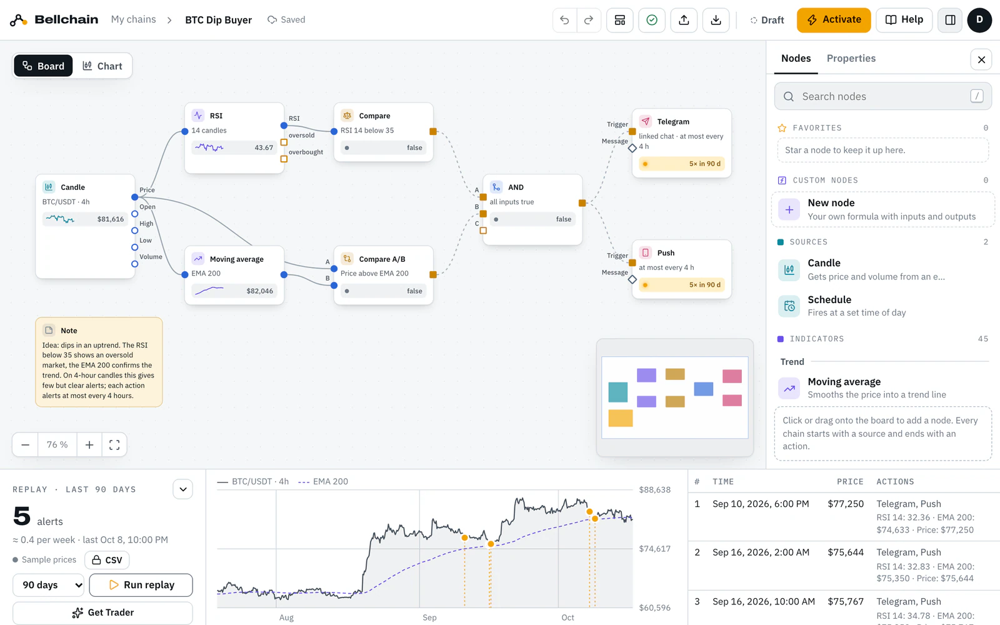
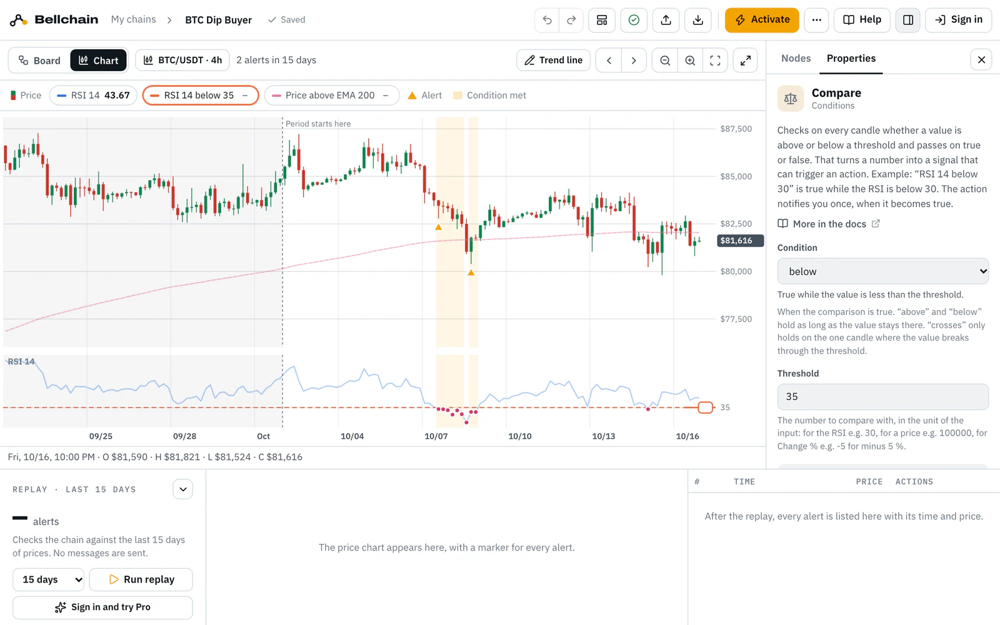

# Bellchain templates

Ready-made crypto alerts for [Bellchain](https://bellchain.app/en/), the no-code builder for crypto alerts. Each template is a chain as JSON: a candle, indicators, conditions and actions. Open it in the editor, test it on real prices with the replay, adjust it and activate it.

Auf Deutsch: [README.de.md](README.de.md)

## Use a template

1. Pick a template from the [list below](#all-templates) and click **Open in Bellchain**. It opens in the editor, no account needed.
2. **Run replay** shows every alert the chain would have sent on real exchange prices.
3. Adjust pair, timeframe or thresholds. The note on the board explains the idea; the template's page in the docs has tips.
4. **Activate** sends real alerts via Telegram, push or email. For that you sign in; there is a free plan.

You can also download a file from `templates/` and load it in the editor under **Import**.

## What's in this repository

| Path | Content |
|---|---|
| `templates/` | One template per file, in the chain format |
| `schema/chain.schema.json` | The chain format as JSON Schema; editors such as VS Code check your file with it |
| `scripts/check.mjs` | The check that runs on every pull request; Node.js 20 or newer, nothing to install |
| `LICENSE` | MIT |

## All templates

<!-- templates -->
### Free (12)

| Template | Idea | Market | In test¹ | Open |
|---|---|---|---:|---|
| [ADA Back Above the EMA 200](templates/trend-return.json) | The price crosses above the EMA 200, and an RSI above 60 shows momentum behind it. | ADA/USDT 1h | 10 | [Open in Bellchain](https://app.bellchain.app/?template=trend-return) · [Docs](https://docs.bellchain.app/en/templates/trend-return/) |
| [AVAX Daily Loss by Email](templates/day-drop.json) | Minus 7 % in 24 hours: one email, at most one a day. | AVAX/USDT 1h | 6 | [Open in Bellchain](https://app.bellchain.app/?template=day-drop) · [Docs](https://docs.bellchain.app/en/templates/day-drop/) |
| [BNB Far Below Average](templates/ma-gap.json) | The price is 3 % below the EMA 50: one push, then a 12-hour cooldown. | BNB/USDT 1h | 3 | [Open in Bellchain](https://app.bellchain.app/?template=ma-gap) · [Docs](https://docs.bellchain.app/en/templates/ma-gap/) |
| [BTC Dip Buyer](templates/dip.json) | RSI below 35 on 4-hour candles, but only while the price is above the EMA 200. | BTC/USDT 4h | 5 | [Open in Bellchain](https://app.bellchain.app/?template=dip) · [Docs](https://docs.bellchain.app/en/templates/dip/) |
| [BTC Golden Cross and Death Cross](templates/golden-cross.json) | The SMA 50 crosses the SMA 200 on 1-hour candles: ▲ golden cross, ▼ death cross. | BTC/USDT 1h | 12 | [Open in Bellchain](https://app.bellchain.app/?template=golden-cross) · [Docs](https://docs.bellchain.app/en/templates/golden-cross/) |
| [DOGE Pump Alert](templates/pump.json) | Plus 4 % in four hours: push and Telegram report the jump, then a 12-hour cooldown. | DOGE/USDT 1h | 10 | [Open in Bellchain](https://app.bellchain.app/?template=pump) · [Docs](https://docs.bellchain.app/en/templates/pump/) |
| [ETH Crash Alarm](templates/crash.json) | Minus 3.5 % in four hours. A 12-hour cooldown so that only one alert comes at night. | ETH/USDT 1h | 3 | [Open in Bellchain](https://app.bellchain.app/?template=crash) · [Docs](https://docs.bellchain.app/en/templates/crash/) |
| [ETH EMA Cross 9/21](templates/ema-cross.json) | The EMA 9 crosses the EMA 21 on 4-hour candles: ▲ up, ▼ down. | ETH/USDT 4h | 38 | [Open in Bellchain](https://app.bellchain.app/?template=ema-cross) · [Docs](https://docs.bellchain.app/en/templates/ema-cross/) |
| [ETH One-Hour Drop](templates/quick-drop.json) | Minus 2 % in one hour, measured on 15-minute candles. One push, then a 3-hour cooldown. | ETH/USDT 15m | 12 | [Open in Bellchain](https://app.bellchain.app/?template=quick-drop) · [Docs](https://docs.bellchain.app/en/templates/quick-drop/) |
| [LINK RSI Watcher](templates/rsi-watch.json) | Writes RSI below 25 and above 75 to the history only, without notifications. | LINK/USDT 1h | 28 | [Open in Bellchain](https://app.bellchain.app/?template=rsi-watch) · [Docs](https://docs.bellchain.app/en/templates/rsi-watch/) |
| [SOL Momentum Burst](templates/momentum.json) | The RSI rises above 70 while the price is above the EMA 200: the uptrend picks up speed. | SOL/USDT 1h | 27 | [Open in Bellchain](https://app.bellchain.app/?template=momentum) · [Docs](https://docs.bellchain.app/en/templates/momentum/) |
| [XRP RSI Turn](templates/rsi-turn.json) | The RSI leaves its extreme zones: ▲ back above 25, ▼ back below 75. | XRP/USDT 1h | 26 | [Open in Bellchain](https://app.bellchain.app/?template=rsi-turn) · [Docs](https://docs.bellchain.app/en/templates/rsi-turn/) |

### Pro (27)

| Template | Idea | Market | In test¹ | Open |
|---|---|---|---:|---|
| [ADA Trend Gains Strength](templates/adx.json) | The ADX rises above 25: ▲ when +DI leads, ▼ when −DI leads. | ADA/USDT 1h | 29 | [Open in Bellchain](https://app.bellchain.app/?template=adx) · [Docs](https://docs.bellchain.app/en/templates/adx/) |
| [Big Moves Across 9 Coins](templates/moves-scanner.json) | When one of the 9 coins moves more than 4 % within an hour, a push names the coin. | 9 coins · 1h (Scanner) | 42 | [Open in Bellchain](https://app.bellchain.app/?template=moves-scanner) · [Docs](https://docs.bellchain.app/en/templates/moves-scanner/) |
| [BNB Hammer or Engulfing](templates/pattern.json) | A hammer or a bullish engulfing while the RSI is below 40. | BNB/USDT 1h | 10 | [Open in Bellchain](https://app.bellchain.app/?template=pattern) · [Docs](https://docs.bellchain.app/en/templates/pattern/) |
| [BNB Turbulence Alert](templates/turbulence.json) | A strong move or four times the volume: one push, then a 12-hour cooldown for all signals. | BNB/USDT 1h | 21 | [Open in Bellchain](https://app.bellchain.app/?template=turbulence) · [Docs](https://docs.bellchain.app/en/templates/turbulence/) |
| [BTC Crosses Round Numbers](templates/round-numbers.json) | BTC closes above (▲) or below (▼) a round level every $10,000. | BTC/USDT 1h | 18 | [Open in Bellchain](https://app.bellchain.app/?template=round-numbers) · [Docs](https://docs.bellchain.app/en/templates/round-numbers/) |
| [BTC High Volatility in a Falling Market](templates/hv-falling.json) | Historical volatility rises above 40 % while BTC has been falling for 24 hours: the market is getting restless. | BTC/USDT 1h | 16 | [Open in Bellchain](https://app.bellchain.app/?template=hv-falling) · [Docs](https://docs.bellchain.app/en/templates/hv-falling/) |
| [BTC Ichimoku Cloud](templates/ichimoku.json) | The price closes two 4-hour candles above the cloud (▲) or below it (▼). | BTC/USDT 4h | 21 | [Open in Bellchain](https://app.bellchain.app/?template=ichimoku) · [Docs](https://docs.bellchain.app/en/templates/ichimoku/) |
| [BTC Monday Weekly Report](templates/weekly-report.json) | Every Monday at 8 AM: price, seven-day change and RSI via Telegram and email. | BTC/USDT 1h | 13 | [Open in Bellchain](https://app.bellchain.app/?template=weekly-report) · [Docs](https://docs.bellchain.app/en/templates/weekly-report/) |
| [BTC RSI Divergence](templates/rsi-divergence.json) | The price makes a lower low while the RSI makes a higher one (▲), or a higher high with a lower RSI (▼). | BTC/USDT 1h | 25 | [Open in Bellchain](https://app.bellchain.app/?template=rsi-divergence) · [Docs](https://docs.bellchain.app/en/templates/rsi-divergence/) |
| [BTC Sell-off, Then Recovery](templates/sequence.json) | First the RSI drops below 30, then within 12 hours the price crosses above the EMA 20. | BTC/USDT 1h | 11 | [Open in Bellchain](https://app.bellchain.app/?template=sequence) · [Docs](https://docs.bellchain.app/en/templates/sequence/) |
| [BTC Stop Alarm with ATR Stop](templates/stop-alarm.json) | A trailing stop three ATRs away: the push arrives when the price breaks it. | BTC/USDT 4h | 18 | [Open in Bellchain](https://app.bellchain.app/?template=stop-alarm) · [Docs](https://docs.bellchain.app/en/templates/stop-alarm/) |
| [BTC Trend Flip with Supertrend](templates/trend.json) | Alerts when the Supertrend flips: ▲ up, ▼ down. | BTC/USDT 1h | 59 | [Open in Bellchain](https://app.bellchain.app/?template=trend) · [Docs](https://docs.bellchain.app/en/templates/trend/) |
| [BTC VWAP Reclaim](templates/vwap.json) | The price crosses above the daily VWAP with double volume, only between 8 AM and 10 PM. | BTC/USDT 15m | 20 | [Open in Bellchain](https://app.bellchain.app/?template=vwap) · [Docs](https://docs.bellchain.app/en/templates/vwap/) |
| [DOGE Volume Explosion](templates/volume-spike.json) | Triple volume and a move of more than 2 % in one hour: ▲ up, ▼ down. | DOGE/USDT 1h | 17 | [Open in Bellchain](https://app.bellchain.app/?template=volume-spike) · [Docs](https://docs.bellchain.app/en/templates/volume-spike/) |
| [ETH Confluence: 3 of 4](templates/confluence.json) | At least three of four signals report “oversold”: RSI, Stoch RSI, Bollinger Band and MFI. | ETH/USDT 1h | 18 | [Open in Bellchain](https://app.bellchain.app/?template=confluence) · [Docs](https://docs.bellchain.app/en/templates/confluence/) |
| [ETH Heikin Ashi Turns With the Trend](templates/heikin-ashi.json) | Heikin Ashi turns green above the EMA 50 (▲) or red below it (▼), on 4-hour candles. | ETH/USDT 4h | 56 | [Open in Bellchain](https://app.bellchain.app/?template=heikin-ashi) · [Docs](https://docs.bellchain.app/en/templates/heikin-ashi/) |
| [ETH MACD Turn](templates/macd.json) | The MACD crosses its signal line: ▲ upwards below the zero line, ▼ downwards above it. | ETH/USDT 4h | 30 | [Open in Bellchain](https://app.bellchain.app/?template=macd) · [Docs](https://docs.bellchain.app/en/templates/macd/) |
| [ETH Squeeze Release](templates/squeeze.json) | After a quiet phase the squeeze releases: ▲ with momentum up, ▼ down. | ETH/USDT 4h | 16 | [Open in Bellchain](https://app.bellchain.app/?template=squeeze) · [Docs](https://docs.bellchain.app/en/templates/squeeze/) |
| [ETH Unusually Calm](templates/calm-rank.json) | ETH volatility drops below percent rank 10: as calm as rarely in the last 30 days. | ETH/USDT 4h | 6 | [Open in Bellchain](https://app.bellchain.app/?template=calm-rank) · [Docs](https://docs.bellchain.app/en/templates/calm-rank/) |
| [ETH Weekly Pivots](templates/pivots.json) | The price breaks above the weekly resistance R1 (▲) or below the weekly support S1 (▼). | ETH/USDT 1h | 14 | [Open in Bellchain](https://app.bellchain.app/?template=pivots) · [Docs](https://docs.bellchain.app/en/templates/pivots/) |
| [LINK Stochastic Turns Low](templates/stoch.json) | %K crosses above %D while the stochastic is below 15. | LINK/USDT 1h | 25 | [Open in Bellchain](https://app.bellchain.app/?template=stoch) · [Docs](https://docs.bellchain.app/en/templates/stoch/) |
| [RSI Scanner Across 9 Coins](templates/rsi-scanner.json) | Reports each of the 9 coins as soon as its RSI drops below 25, at most every 12 hours per coin. | 9 coins · 1h (Scanner) | 82 | [Open in Bellchain](https://app.bellchain.app/?template=rsi-scanner) · [Docs](https://docs.bellchain.app/en/templates/rsi-scanner/) |
| [SOL Breakout with Volume](templates/brk.json) | The 20-candle high breaks and volume is well above average. | SOL/USDT 1h | 35 | [Open in Bellchain](https://app.bellchain.app/?template=brk) · [Docs](https://docs.bellchain.app/en/templates/brk/) |
| [SOL Pullback to 61.8 %](templates/fibonacci.json) | After a rise the price falls back to the 61.8 % Fibonacci level, the golden ratio. | SOL/USDT 1h | 26 | [Open in Bellchain](https://app.bellchain.app/?template=fibonacci) · [Docs](https://docs.bellchain.app/en/templates/fibonacci/) |
| [SOL Pullback to the Breakout](templates/breakout-retest.json) | After a breakout above the 20-candle high, SOL comes back within ±0.5 % of the breakout price within 8 hours. | SOL/USDT 1h | 33 | [Open in Bellchain](https://app.bellchain.app/?template=breakout-retest) · [Docs](https://docs.bellchain.app/en/templates/breakout-retest/) |
| [Volume Breakouts Across 9 Coins](templates/breakout-scanner.json) | One of the 9 coins breaks its 50-candle high on more than three times the volume. | 9 coins · 1h (Scanner) | 71 | [Open in Bellchain](https://app.bellchain.app/?template=breakout-scanner) · [Docs](https://docs.bellchain.app/en/templates/breakout-scanner/) |
| [XRP Back Inside the Bollinger Band](templates/bb-rebound.json) | The price closes back above the lower Bollinger Band while the RSI is still below 35. | XRP/USDT 1h | 23 | [Open in Bellchain](https://app.bellchain.app/?template=bb-rebound) · [Docs](https://docs.bellchain.app/en/templates/bb-rebound/) |

### Trader (23)

| Template | Idea | Market | In test¹ | Open |
|---|---|---|---:|---|
| [AVAX Breaks Structure Downward](templates/structure-down.json) | Alerts on a downward break of market structure: BOS in a downtrend, CHoCH when an uptrend tips over. | AVAX/USDT 1h | 27 | [Open in Bellchain](https://app.bellchain.app/?template=structure-down) · [Docs](https://docs.bellchain.app/en/templates/structure-down/) |
| [BNB Gap Half Filled](templates/fvg-half.json) | The price fills an up gap of 0.5 % or more halfway, the middle many traders watch. | BNB/USDT 1h | 12 | [Open in Bellchain](https://app.bellchain.app/?template=fvg-half) · [Docs](https://docs.bellchain.app/en/templates/fvg-half/) |
| [BTC and ETH Fall Together](templates/risk-off.json) | BTC loses 2 % and ETH 2.5 % in four hours: a webhook to your system and a push. | BTC/USDT, ETH/USDT 1h | 5 | [Open in Bellchain](https://app.bellchain.app/?template=risk-off) · [Docs](https://docs.bellchain.app/en/templates/risk-off/) |
| [BTC Breaks Structure Upward](templates/structure-break.json) | Alerts on an upward break of market structure: BOS in an uptrend, CHoCH at the turn. | BTC/USDT 1h | 30 | [Open in Bellchain](https://app.bellchain.app/?template=structure-break) · [Docs](https://docs.bellchain.app/en/templates/structure-break/) |
| [BTC Donchian Breakout as a Webhook](templates/donchian-webhook.json) | A close above the 20-candle high or below the 20-candle low of the Donchian Channel, as a webhook to your system. | BTC/USDT 4h | 30 | [Open in Bellchain](https://app.bellchain.app/?template=donchian-webhook) · [Docs](https://docs.bellchain.app/en/templates/donchian-webhook/) |
| [BTC Pi Cycle Top](templates/pi-cycle-top.json) | Alerts when BTC’s 111-day average crosses above twice its 350-day average: the well-known Pi Cycle Top. | BTC/USDT 1d | 0 | [Open in Bellchain](https://app.bellchain.app/?template=pi-cycle-top) · [Docs](https://docs.bellchain.app/en/templates/pi-cycle-top/) |
| [BTC Pullback to the $87,083 Breakout Level](templates/breakout-level-retest.json) | After a daily close above $87,083, alerts when BTC comes back within ±1 % of the breakout price within 20 days. | BTC/USDT 1d | 0 | [Open in Bellchain](https://app.bellchain.app/?template=breakout-level-retest) · [Docs](https://docs.bellchain.app/en/templates/breakout-level-retest/) |
| [BTC Retest After the Break](templates/structure-retest.json) | After an upward break of structure, the price comes back to the broken level, within ±0.3 %. | BTC/USDT 4h | 17 | [Open in Bellchain](https://app.bellchain.app/?template=structure-retest) · [Docs](https://docs.bellchain.app/en/templates/structure-retest/) |
| [BTC Reversal in Discount](templates/choch-discount.json) | The smaller market structure turns up (CHoCH) while the price sits in the lower half of the range. | BTC/USDT 1h | 5 | [Open in Bellchain](https://app.bellchain.app/?template=choch-discount) · [Docs](https://docs.bellchain.app/en/templates/choch-discount/) |
| [BTC Rotates Around Yesterday’s POC](templates/poc-rotation.json) | Alerts when the price rotates within ±0.3 % around yesterday’s POC for four hours. | BTC/USDT 15m | 25 | [Open in Bellchain](https://app.bellchain.app/?template=poc-rotation) · [Docs](https://docs.bellchain.app/en/templates/poc-rotation/) |
| [BTC Volatility Regime](templates/vola-regime.json) | Alerts when BTC’s 30-day volatility is as high (▲) or as low (▼) as on hardly any day in the past year. | BTC/USDT 1d | 1 | [Open in Bellchain](https://app.bellchain.app/?template=vola-regime) · [Docs](https://docs.bellchain.app/en/templates/vola-regime/) |
| [BTC Weekly Close Above $124,824](templates/weekly-close-level.json) | A BTC weekly close above $124,824 to Telegram and webhook, plus weekly closes above and below round 10,000s. | BTC/USDT 1w | 4 | [Open in Bellchain](https://app.bellchain.app/?template=weekly-close-level) · [Docs](https://docs.bellchain.app/en/templates/weekly-close-level/) |
| [BTC Weekly Close and the 50-Week Average](templates/weekly-close-50w.json) | Alerts when BTC closes a week below (▼) or back above (▲) the 50-week average; the week closes Sunday 24:00 UTC. | BTC/USDT 1w | 1 | [Open in Bellchain](https://app.bellchain.app/?template=weekly-close-50w) · [Docs](https://docs.bellchain.app/en/templates/weekly-close-50w/) |
| [Bullish RSI Divergence on Daily Candles](templates/divergence-daily.json) | Reports for BTC, ETH and SOL when the price makes a lower low on daily candles but the RSI makes a higher one. | BTC, ETH, SOL · 1d (Scanner) | 1 | [Open in Bellchain](https://app.bellchain.app/?template=divergence-daily) · [Docs](https://docs.bellchain.app/en/templates/divergence-daily/) |
| [Daily Close Below the 20-Day Average](templates/close-below-sma.json) | Reports for BTC, ETH and SOL every daily close below the 20-day average, once when it crosses, each coin on its own. | BTC, ETH, SOL · 1d (Scanner) | 15 | [Open in Bellchain](https://app.bellchain.app/?template=close-below-sma) · [Docs](https://docs.bellchain.app/en/templates/close-below-sma/) |
| [ETH Breakout from an S/R Zone](templates/sr-breakout.json) | The price closes above a resistance zone or below a support zone made of three or more swings. | ETH/USDT 4h | 29 | [Open in Bellchain](https://app.bellchain.app/?template=sr-breakout) · [Docs](https://docs.bellchain.app/en/templates/sr-breakout/) |
| [ETH Parabolic SAR to Your System](templates/psar-webhook.json) | Every Parabolic SAR flip goes to your address as a webhook: ▲ up, ▼ down. | ETH/USDT 4h | 39 | [Open in Bellchain](https://app.bellchain.app/?template=psar-webhook) · [Docs](https://docs.bellchain.app/en/templates/psar-webhook/) |
| [ETH Pullback into a Fair Value Gap](templates/fvg-pullback.json) | In an uptrend, the price falls back into an open up gap of 0.3 % or more. | ETH/USDT 1h | 33 | [Open in Bellchain](https://app.bellchain.app/?template=fvg-pullback) · [Docs](https://docs.bellchain.app/en/templates/fvg-pullback/) |
| [LINK Order Block in Discount](templates/ob-discount.json) | The price returns for the first time to a bullish order block that sits in the cheap half of the range. | LINK/USDT 1h | 16 | [Open in Bellchain](https://app.bellchain.app/?template=ob-discount) · [Docs](https://docs.bellchain.app/en/templates/ob-discount/) |
| [SOL Keltner Breakout as a Webhook](templates/keltner-webhook.json) | The price leaves the Keltner Channel: ▲ up, ▼ down, as a webhook. | SOL/USDT 1h | 40 | [Open in Bellchain](https://app.bellchain.app/?template=keltner-webhook) · [Docs](https://docs.bellchain.app/en/templates/keltner-webhook/) |
| [SOL Sweep Below the Low, Then Reversal](templates/sweep-reversal.json) | First the price spikes below a swing low and closes back above it, then the structure breaks upward within 24 candles. | SOL/USDT 1h | 12 | [Open in Bellchain](https://app.bellchain.app/?template=sweep-reversal) · [Docs](https://docs.bellchain.app/en/templates/sweep-reversal/) |
| [XRP Oversold Journal](templates/journal.json) | When two of three oscillators report “oversold”, the chain sends RSI, CCI and Williams %R to your system. | XRP/USDT 1h | 48 | [Open in Bellchain](https://app.bellchain.app/?template=journal) · [Docs](https://docs.bellchain.app/en/templates/journal/) |
| [XRP Sweep Above Equal Highs](templates/eqh-sweep.json) | Two swing highs sit at almost the same level; the price spikes above them and closes back below right away. | XRP/USDT 1h | 6 | [Open in Bellchain](https://app.bellchain.app/?template=eqh-sweep) · [Docs](https://docs.bellchain.app/en/templates/eqh-sweep/) |

### Community (5)

| Template | Idea | Market | In test¹ | Open |
|---|---|---|---:|---|
| [AVAX 14-Day High and Low](templates/new-high.json) | When AVAX closes higher or lower than at any time in 14 days, the chain posts at most once a day. | AVAX/USDT 1h | 15 | [Open in Bellchain](https://app.bellchain.app/?template=new-high) · [Docs](https://docs.bellchain.app/en/templates/new-high/) |
| [Big Moves in BTC, ETH and SOL](templates/market-movers.json) | When BTC, ETH or SOL moves more than 2 % within an hour, the chain posts to your Discord channel. | BTC/USDT, ETH/USDT, SOL/USDT 1h | 29 | [Open in Bellchain](https://app.bellchain.app/?template=market-movers) · [Docs](https://docs.bellchain.app/en/templates/market-movers/) |
| [BTC Aroon Trend Change for Discord](templates/aroon.json) | Aroon Up crosses Aroon Down above 70 (▲) or the other way round (▼), as a post in your Discord channel. | BTC/USDT 4h | 35 | [Open in Bellchain](https://app.bellchain.app/?template=aroon) · [Docs](https://docs.bellchain.app/en/templates/aroon/) |
| [BTC Morning Briefing for Your Community](templates/morning-briefing.json) | Every morning at 8 AM: price, 24-hour change and RSI to Discord and a Telegram group. | BTC/USDT 1h | 90 | [Open in Bellchain](https://app.bellchain.app/?template=morning-briefing) · [Docs](https://docs.bellchain.app/en/templates/morning-briefing/) |
| [ETH Swing Breakout with OBV](templates/swing-break.json) | The price breaks above the last swing high (▲) or below the swing low (▼), and OBV confirms the direction. | ETH/USDT 4h | 20 | [Open in Bellchain](https://app.bellchain.app/?template=swing-break) · [Docs](https://docs.bellchain.app/en/templates/swing-break/) |

¹ Alerts in a 90-day replay with sample prices up to 17 Oct 2026. The plan is the smallest one that can activate the template; testing works on every plan.
<!-- /templates -->

## Contribute a template

Built a chain that others could use? Share it here. We review every template; once merged, it appears in the gallery of the app with the next release.

1. **Build and test** the chain in the [editor](https://app.bellchain.app/) and run the replay.
2. **Export** it: **Export** → **Download** saves the chain as JSON. URLs of webhooks and Discord stay out of the file.
3. **Fork** this repository and add the file as `templates/<name>.json`, for example `templates/eth-rsi-bounce.json`. In the browser: **Add file** → **Upload files**.
4. **Add the texts** under `meta`: title, description, note, messages and tips, in German and English. [CONTRIBUTING.md](CONTRIBUTING.md) has an example.
5. **Check** it: `node scripts/check.mjs templates/eth-rsi-bounce.json`. Every message names the line and what to change.
6. **Open a pull request.** The same check runs on GitHub and marks problems right in your file.
7. **Review:** we test the template with the sample prices, add "In test" and merge it.

Step by step with all rules: [CONTRIBUTING.md](CONTRIBUTING.md) · [Contribute](https://docs.bellchain.app/en/contribute/) in the docs. Ideas without a finished chain are welcome as an [issue](https://github.com/bellchain-app/templates/issues/new/choose).

Your own nodes with formulas live in [bellchain-app/nodes](https://github.com/bellchain-app/nodes).

## License

MIT, see [LICENSE](LICENSE). Contributions are published under the same license.

Bellchain sends alerts. It doesn't trade, hold funds or give investment advice.
